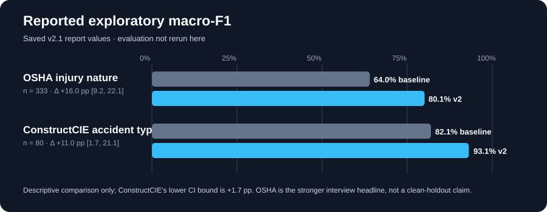
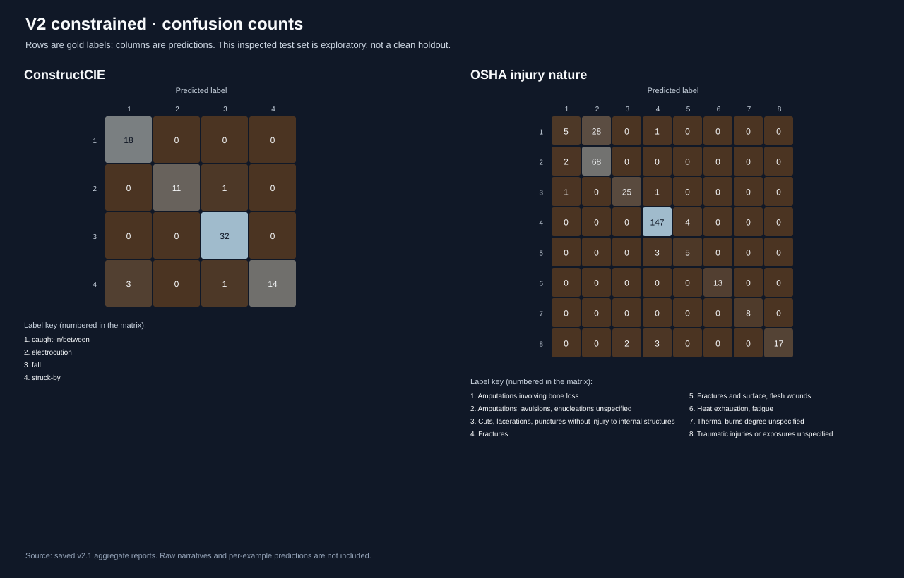

# CaseStruct-LoRA

**A reproducible local LoRA study of incident-text classification and evaluation.**

CaseStruct trains a Qwen3-0.6B adapter using [PEFT](https://github.com/huggingface/peft) and [TRL](https://github.com/huggingface/trl) and evaluates two distinct tasks: construction accident type (ConstructCIE) and occupational injury nature (OSHA Severe Injury Reports). The earlier synthetic legal-intake prototype remains in `src/casestruct/` for historical reproducibility. **Neither external benchmark is a legal-document dataset.** The system is not validated for legal, clinical, or safety-critical use.



The OSHA result is the stronger interview headline. ConstructCIE's 80-case result is suggestive, not conclusive: its reported 95% paired-bootstrap interval has a lower bound of only +1.7 percentage points.

## At a glance

| External task | N | Strongest evaluated non-v2 baseline macro-F1 | v2 constrained macro-F1 | Paired bootstrap gain (95% CI) |
|---|---:|---:|---:|---:|
| **OSHA injury nature** | 333 | 64.0% (base few-shot) | **80.1%** | **+16.0 pp** [+9.2, +22.1] |
| ConstructCIE accident type | 80 | 82.1% (v1 zero-shot) | **93.1%** | **+11.0 pp** [+1.7, +21.1] |

These results were regenerated from commit 8ca6f59d1f7313cb7699e16e55b60d067e960016 on 2026-11-07. The test set was inspected during development, so they are not pristine holdout estimates. Confidence intervals use 10,000 paired bootstrap resamples (seed 71), and strongest-baseline selection was retrospective. Do not average the two different tasks. OSHA administrative codes are not always recoverable from narratives. Sanitized results for all nine conditions—including metrics, per-class scores, and confusion counts—are in [`docs/results-aggregate.json`](docs/results-aggregate.json); [`docs/confusion-matrices-v2.svg`](docs/confusion-matrices-v2.svg) visualizes the v2-constrained matrices. Headline values and provenance are in [`docs/results-summary.json`](docs/results-summary.json) and [`docs/results.md`](docs/results.md). Raw narratives and per-example predictions were not copied. The adjudicated error-row sample and caveats are in [`docs/error-analysis.md`](docs/error-analysis.md).



## Get started

Requires Linux, Python 3.11/3.12, [`uv`](https://docs.astral.sh/uv/), and an NVIDIA CUDA GPU for training (tested on an RTX 3070 Ti with ~8 GB VRAM). Inference demos also run on CPU, but can be substantially slower and are not benchmarked here. Public base-model weights download from Hugging Face; adapter weights and datasets are **not** distributed in this repository. The adapter's research scope and limitations are documented in [`model/README.md`](model/README.md); this is a model card, not a claim that weights have been released.

```bash
uv sync --extra dev
bash run.sh test
bash run.sh fetch
bash run.sh prepare
bash run.sh train-v2      # only if an adapter does not already exist; may train
bash run.sh evaluate      # no training; audit first, then fair baselines and report
```

If you are **reusing a trained v2 adapter**, place it at `outputs/v2/adapter` and prepared splits at `data/v2/`. To reproduce the full nine-condition evaluation, the original v1 adapter at `outputs/local/adapter` and v2 test predictions at `reports/v2/v2-test.predictions.jsonl` are also required. `bash run.sh evaluate` explicitly refuses to proceed if those prerequisites are absent; it does not retrain.

**One-command everyday workflow:** `bash run.sh --help` lists commands. Example demo (use fictional inputs only):

```bash
bash run.sh demo constructcie 'A worker fell from a scaffold and fractured their arm.'
bash run.sh benchmark constructcie 'A worker fell from a scaffold and fractured their arm.'
```

The benchmark repeats one input 51 times; reports p50/p95, generated tokens/s and CUDA allocator peak where available. It is a microbenchmark, not a representative workload study. CPU inference is supported, but CPU benchmark results are not provided.

## Repository structure

```text
run.sh                      sole root workflow launcher
scripts/                    workflows plus sanitized aggregate-report exporter
src/casestruct/             historical synthetic intake experiment
src/casestruct/external.py  public dataset downloader and normalization
src/casestruct/v2/          external-data preparation, training, inference, evaluation
src/casestruct/v21/         audit, 9-condition baselines, statistics, error analysis, demo
configs/                    reproducible experiment configuration
tests/                     unit tests (no model weights required)
docs/                       results, aggregate metrics/confusions, methodology, provenance
model/README.md              adapter model card; no weights are hosted here
data/, outputs/, reports/    generated locally; ignored by git
```

## Reproducibility and integrity

- Dataset preparation uses seed 71, grouped normalized narratives and task-specific label stratification. Hashes and label vocabularies are written to `data/v2/manifest.json`.
- v2 training uses a prompt/completion dataset, `completion_only_loss=True`, and LoRA rank 8 / alpha 16. The saved v2 training run used W&B offline logging; no public run URL is available. The TRL collator was checked on a batch of 32 prepared training examples: every prompt token was labeled `-100`, and every token in every completion (including EOS) was supervised. `tests/test_training_mask.py` verifies the supervised-token count against each tokenized completion. This confirms the checked-in code path, not historical training runs or checkpoint provenance.
- v2.1 evaluates base, v1, and v2 × zero-shot, four-shot, and constrained label scoring. Constrained choice uses total conditional log-likelihood; length-normalized scores are secondary. Strict JSON validity is N/A for the constrained method.
- v2.1 audit stops on cross-split exact duplicates, very high near-duplicate similarity, manifest inconsistencies, or checked-in training-source concerns. It is not proof of zero semantic leakage.
- Bootstrap comparisons use paired case IDs and a fixed label vocabulary. Error samples are **proposed**, not adjudicated; review `reports/v2.1/errors_to_review.csv` before publication.

For provenance, commands and limitations, read [`docs/methodology.md`](docs/methodology.md). Full evaluation outputs can be generated locally with `bash run.sh evaluate`; generated per-example reports are intentionally not committed because they contain source narratives and sensitive descriptions. A new clean holdout should be collected only after freezing the model, label mapping, and analysis plan; see [`docs/results.md`](docs/results.md).

## Limitations and responsible use

Only public accident narratives are used; incidents may include sensitive medical or personal information. Check original source terms and privacy before redistributing **raw data, model predictions, or artifacts**. ConstructCIE has only 80 test cases. Near-duplicates, label noise, and inferential gaps remain possible. Strong few-shot baselines substantially narrow gains over unmodified Qwen3. These results establish neither deployment readiness nor suitability for legal, medical, or safety decisions.

## Development history

Project milestones and source provenance are documented in [`docs/HISTORY.md`](docs/HISTORY.md).

## License

This project’s original code is licensed under the [MIT License](LICENSE). This license does not extend to external datasets, model weights, or third-party materials; consult [`docs/methodology.md`](docs/methodology.md) and each source’s terms before using or redistributing them.
